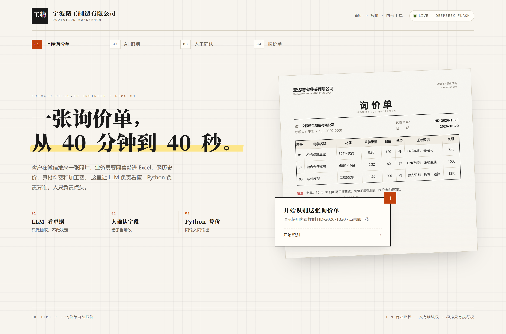
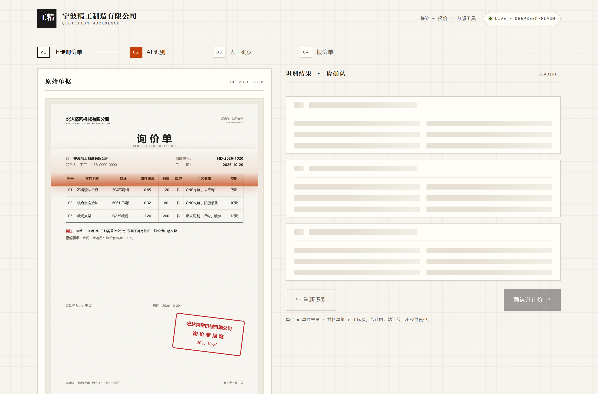
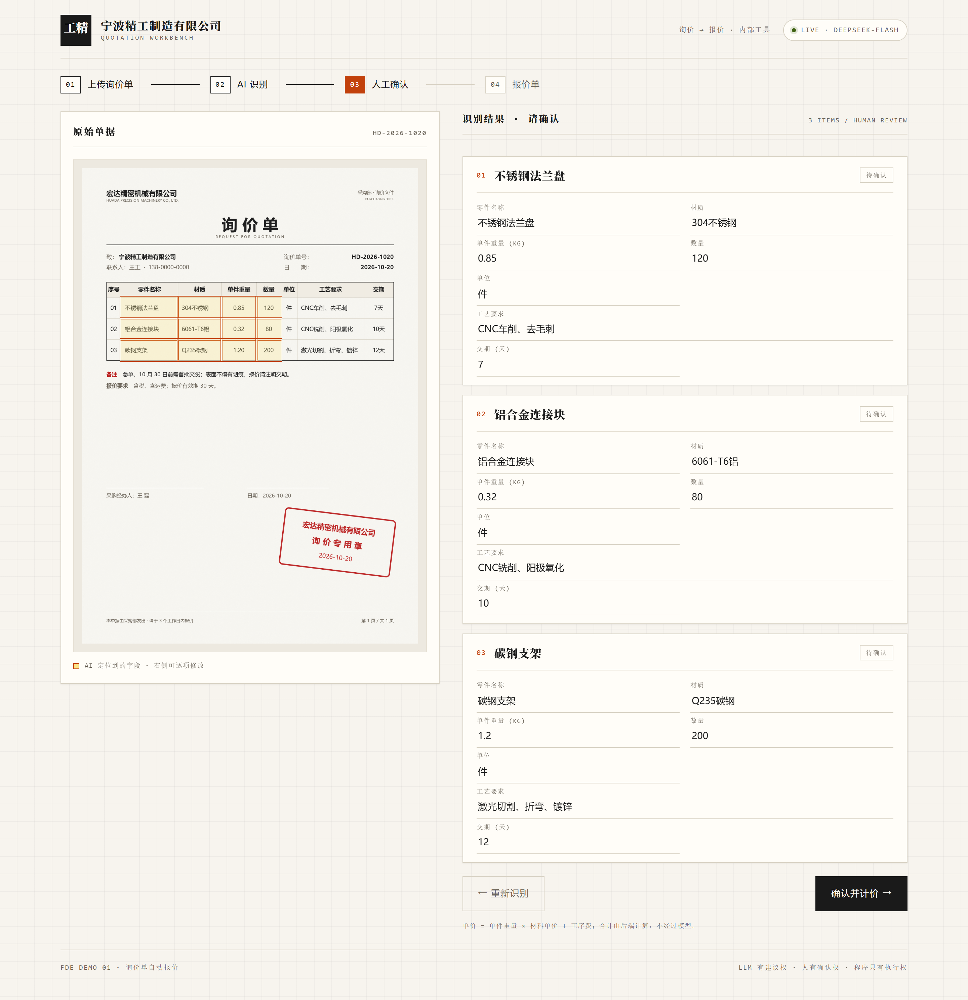
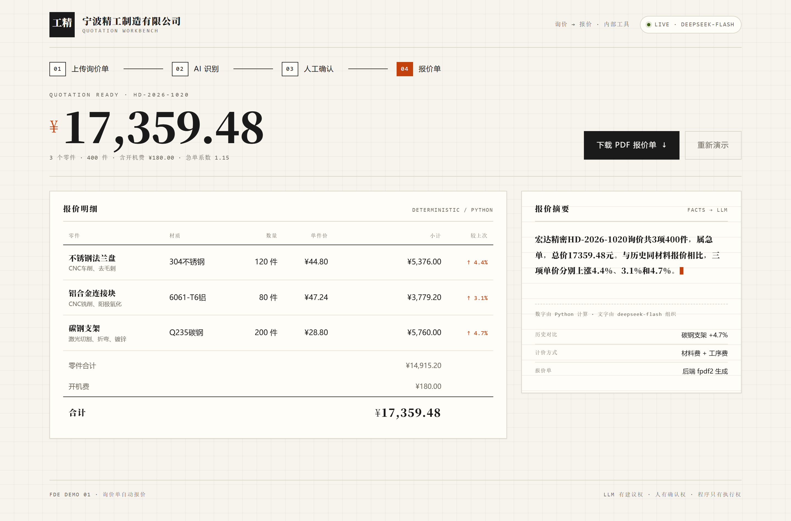
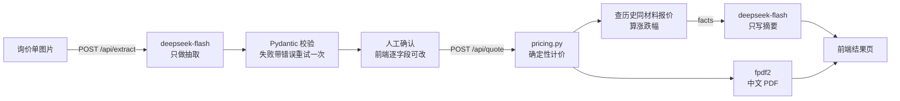

# FDE Demo 01 · 询价单自动报价

一张客户发来的询价单照片，进去；一份可下载的中文 PDF 报价单，出来。



一个面向五金 / 机加工小工厂的落地演示：业务员收到微信里的询价单照片，原本要照着敲进 Excel、翻历史报价、手算材料费和加工费、再排版成报价单。这个 demo 把这段流程压缩成 **上传 → 识别 → 人工确认 → 报价单** 四步。

---

## 一条原则：模型负责理解，程序负责计算

这是整个项目唯一不能让步的设计。

| 环节 | 谁做 | 为什么 |
| --- | --- | --- |
| 看懂图片、抽取字段 | `deepseek-flash` | 格式千奇百怪，规则写不完，这是模型擅长的 |
| 字段校验、缺失重试 | Pydantic + Python | 模型会漏字段、会写错类型，程序必须兜底 |
| 确认 / 修改字段 | 人 | 报错价的代价由人承担，所以人要有最后决定权 |
| 单价、合计、同比 | `pricing.py` | 同样的输入必须得到同样的输出，不能有随机性 |
| 中文摘要的措辞 | `deepseek-flash` | 只拿 Python 算好的事实去组织语言，不允许改数字 |
| PDF 排版 | `fpdf2` | 后端生成，前端只负责下载 |

一句话：**LLM 有建议权，人有确认权，程序只有执行权。**

模型输出的任何数字，都要先通过 Pydantic 校验；计价全程不经过模型。摘要接口拿到的是 `facts`（已经算好的数字），提示词里明确写了「只使用 JSON 里的数字，不要编造原因」。

---

## 界面

| 01 上传 | 02 识别中 |
| --- | --- |
|  |  |

| 03 人工确认 | 04 报价结果 |
| --- | --- |
|  |  |

后端生成的 PDF：[screenshots/quotation.pdf](screenshots/quotation.pdf) · 预览图 [screenshots/05-pdf.png](screenshots/05-pdf.png)

识别结果落到右侧卡片里，每个字段都可以直接改；改完再点「确认并计价」。左边单据上的高亮框是字段定位，用来让业务员一眼看到「AI 到底读到了什么」。

---

## 架构



四个接口都只做一件事：

| 接口 | 输入 | 输出 |
| --- | --- | --- |
| `POST /api/extract` | 图片 base64 | 结构化订单 + 零件行 + 高亮坐标 |
| `POST /api/quote` | 人工确认后的字段 | 单价、小计、开机费、急单系数、历史对比 |
| `POST /api/summary` | `facts` | 2–3 句中文摘要 |
| `POST /api/pdf` | 订单 + 零件行 | 可下载的 PDF 字节流 |

`GET /api/health` 会返回当前是 `live` 还是 `demo` 模式。

---

## 计价规则

```
单件价 = 单件重量(kg) × 材料单价(元/kg) + Σ 工序费
行小计 = 单件价 × 数量
小计   = Σ 行小计 + 开机费（含 CNC 时收 180 元）
合计   = 小计 × 急单系数（急单 1.15，否则 1.0）
```

材质名称会先做归一化再查表（`304` / `SUS304` / `304不锈钢` / `06Cr19Ni10` 都指向同一种料），工序按 `、，+/；` 切分后逐项匹配。这些都在 [backend/pricing.py](backend/pricing.py) 里，纯函数，没有任何模型调用。

样例数据的结果是固定的：

- 三个零件单件价 `44.80 / 47.24 / 28.80`
- 零件合计 `14,915.20`，加开机费后 `15,095.20`
- 急单 ×1.15，**合计 17,359.48**
- 与历史同材料报价相比分别 `+4.4% / +3.1% / +4.7%`
- 人民币大写 `壹万柒仟叁佰伍拾玖元肆角捌分`

---

## 快速开始

需要 Python 3.10+；如果要重新构建前端，再需要 Node 18+。

**Windows**

```bat
run.bat
```

**macOS / Linux**

```bash
chmod +x run.sh && ./run.sh
```

脚本会自动创建虚拟环境、装依赖、首次运行时构建前端，然后打开 <http://127.0.0.1:8000>。

想接真实模型：

```bash
cp .env.example .env
# 填入 DEEPSEEK_API_KEY
# 保持 DEMO_MODE=0
```

手动启动：

```bash
.venv/Scripts/python -m uvicorn backend.main:app --host 127.0.0.1 --port 8000
# 前端开发模式（热更新）：cd frontend && npm run dev
```

---

## 演示模式

**没有配置 `DEEPSEEK_API_KEY` 时自动进入演示模式**，不需要改任何代码：识别结果读 `backend/data/demo_extraction.json`，摘要读 `backend/data/demo_summary.txt`，计价和 PDF 仍然真实计算、真实生成。

这样做有两个原因：一是别人 clone 下来不配 key 也能完整跑通，二是公开部署时不会有人拿我的 key 刷接口。API key 只存在于服务端的 `.env`，已被 `.gitignore` 排除。

---

## 目录结构

```
fde-demo1/
├── backend/
│   ├── main.py            FastAPI 路由、静态资源、请求日志
│   ├── llm.py             抽取 / 摘要两个模型调用，含演示模式
│   ├── pricing.py         确定性计价（零 LLM）
│   ├── pdf_generator.py   fpdf2 中文报价单 + 人民币大写
│   ├── models.py          Pydantic 数据契约
│   ├── storage.py         JSON 读写，接口留在这一层
│   └── data/              价格表、历史报价、演示数据
├── frontend/src/          React：Hero / Workspace / Result
├── scripts/
│   ├── generate_inquiry.py  生成样例询价单图片和字段坐标
│   ├── test_backend.py      计价与 PDF 的确定性自测
│   └── shoot.py             用 Playwright 跑完整流程并截图
└── screenshots/
```

存储刻意收在 `storage.py` 一个文件里：现在读写 JSON，换成 SQLite 或 Postgres 时只需要改这一层，上层代码不用动。

---

## 已知边界

现场能讲清楚「哪里还没做好」，比假装做完更重要。

- **高亮框是预置坐标，不是模型定位。** DeepSeek 目前的视觉接口不支持 bbox / grounding，所以坐标是在生成样例单据时一并产出的（`scripts/generate_inquiry.py`）。换成支持检测的模型或接 OCR 版面分析后，这一层可以直接替换。
- **未知工序会被忽略，不计价。** 匹配不是模糊语义匹配，`pricing.py` 会把没匹配上的工序记进 `unknown_processes`，但不会报价——生产环境应该把这类行标红，交给人处理。
- **金额用 float，生产环境应换 `Decimal`。** 现在是两位小数四舍五入，样例量级下没问题，真实财务口径不能这么写。
- **JSON 文件不适合并发。** 多人同时报价会互相覆盖，所以这里只作为演示；接口已经隔离在 `storage.py`。
- **没有登录、权限、审计。** 真实落地时，谁能改价、谁批准了这版报价，都需要留痕。
- **单页 PDF。** 零件行多了会溢出，需要分页逻辑。

下一步如果继续做，我会按这个顺序：把报价落库并加审批流 → 未知工序标红 → 报价版本对比（不只是和历史价对比）→ 再接真实的单据识别。

---

## 一些取舍

- **为什么让人确认一遍？** 因为这是报价，不是记账。少一个「0」的代价远大于多点一次鼠标。人工确认这一步也是整个 demo 想表达的东西：AI 可以很快，但责任要有人接。
- **为什么摘要交给模型，而不是模板？** 模板能保证正确，但读起来像系统通知。摘要的输入只有事实，模型没有机会编数字，所以这里可以让它写得更像人话；真出问题还有 `template_summary()` 兜底。
- **为什么前端用模拟动画？** 识别本身是同步请求，进度条是假的。演示要的是让人看懂「在做什么」，不需要为了动画去拆 SSE。
